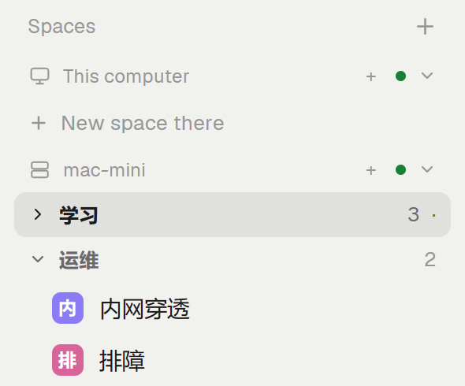

# space-groups

A replacement for Herdr's Spaces sidebar that groups named spaces by prefix.
Each machine gets its own groups. A folded group shows its member count, its
highest-priority agent status, and a highlight if it contains the selected
space. Fold state is kept locally by Herdr for this mod copy.



## Status

This is a personal project with no maintenance guarantee, and issues are welcome.

## Naming

Name a space `Study·anki` to display `anki` under `Study`. The first middle dot
(`·`, U+00B7) splits the name and surrounding whitespace is trimmed on each side.
For example, ` Study · Languages·Anki ` appears as `Languages·Anki` under
`Study`. Names without a middle dot and automatic space names stay standalone.
An empty prefix appears as `(empty group)` and an empty suffix gives a blank
row label.

Groups appear where their first member occurs. Members keep their order,
with the usual exception that linked worktrees sit under their first main
checkout when both share a group. For example, use `Work·repo` and
`Work·feature-a` for a repo and its worktree.

## Drag and drop

Drag within one machine in the expanded sidebar. Hover over a space row's
upper half to insert before it, or its lower half to insert after it. The
insertion line shows where the space or group will move.

- Drop a space on a group heading, including a folded one, to move it to
  the end of that group. Drop it on a member to insert it before or after
  that member. Moving between groups replaces the old name prefix. Moving
  between members of the same group keeps the name.
- Drop a grouped space on a standalone space to remove its first prefix.
  An empty display name keeps the existing name. If the remaining name
  contains another middle dot, that dot still defines a group.
- An automatic name becomes an explicit name when dropped into a group.
  The new name uses the group's prefix and the space's current display name.
- Drag a group heading to move all of its members in their original order.
  Their names stay the same. Drop on another heading to place the group
  before its first member or after its last member. Press and release on
  the same heading to fold it, or on the same space to select it.
- While dragging, **Move to end** appears below the source machine's
  spaces. If the sidebar shows machine headings, drop on the source
  machine's heading to move to the top. A grouped space dropped at either
  target loses its first prefix if its display name is nonempty.
  An automatic name stays automatic. A whole group keeps its names and
  member order. This works even when every space has a prefix.

The order is changed in Herdr. Worktree nesting still affects the visible
order. Herdr shows an error if the planned name or order cannot be confirmed
within about two seconds.

## Install

1. Locate the app home. The defaults are `~/.config/herdr-app` on macOS and
   `%USERPROFILE%\.config\herdr-app` on Windows. On Windows, if Herdr is
   missing from `PATH`, use the full path to `herdr-app.exe` in your Herdr
   installation directory.
2. Copy this project's `mods/space-groups` directory into the app home's
   `mods` directory. If you have a Git checkout, copy that same subdirectory
   from the checkout. The result should be `<app home>/mods/space-groups/main.js`.
3. With Herdr Desktop open on the client, clone the built-in layout.

   ```sh
   herdr-app do layout.clone '{"name":"main","as":"main-groups"}'
   ```

   In Windows shells where quoting JSON is awkward, the app also accepts
   `herdr-app do layout.clone --name main --as main-groups`.
4. In `<app home>/layouts/main-groups.json`, change the Spaces block from
   `"mod": "spaces"` to `"mod": "space-groups"` and save. The clone command
   switches to `main-groups`. You can also select it from Herdr's layout picker.

## Uninstall

Switch the window back to the `main` layout. Remove the
`<app home>/mods/space-groups` directory and, if you no longer use the cloned
layout, `<app home>/layouts/main-groups.json`.

## Compatibility and known limits

Tested on Herdr 0.1.15 (macOS) and 0.1.16 (Windows). macOS validation used
the mod checker. Windows validation used the desktop client.

- The narrow rail uses the original numbered cells and per-space status
  glyphs. Group drops are available in the expanded sidebar. Machine
  folding applies in both modes.
- The expanded sidebar nests linked worktrees within their own prefix group.
  A workspace whose main checkout has a different prefix, or has no prefix,
  appears in its own group or as a standalone row according to its name.
  Nesting within a prefix group affects the sidebar presentation. Ungrouped
  worktrees retain the built-in automatic ordering.
- This is a copy of the Spaces mod shipped with Herdr 0.1.15. Herdr upgrades
  do not merge fixes into this mod automatically. The mod uses the shipped
  `menu` overlay and `workspace-chrome` icons.

## Development

Run `herdr-app check ./mods/space-groups` to load and render the mod once.
Use `herdr-app check ./mods/agent-groups` for the Agents mod.
Herdr may generate `gpui-kit.d.ts` in the mod directory when checking or
loading it. The generated declaration is ignored by Git. The pure grouping
tests use Node.js 22+ and require no dependencies.

```sh
node --test tests/
```

Licensed under Apache-2.0. See [LICENSE](LICENSE) and [NOTICE](NOTICE).

## Agent Groups

`agent-groups` is an optional replacement for Herdr's Agents panel. Select
**Grouped by space** in the sort menu. On each machine, agents from
`Study·anki` and `Study·reading` share a **Study** heading, with **anki**
and **reading** on the agent rows. Automatic and unprefixed space names
keep one group per space. Priority, pinned agents, sub-agent trees,
remote machine labels and the compact rail work as in the built-in panel.

In the wide **Grouped by space** view, drag a group heading to another
heading on the same machine. The upper half inserts before the target
group and the lower half inserts after it. This moves all spaces in the
source group, including those without agents, and preserves their names.
The new order also appears in Spaces. Pinned and Priority groups and the
compact rail keep their existing controls.

Fold a group to keep its status summary visible. A separate accent dot
appears if an agent or a visible member's known descendant becomes
**Done** or **Blocked** after the fold and still has that status.
Opening the group clears the dot. The current client stores the folds and
observed status times locally. Changes that occur while the panel is
closed can only be detected when the panel next sees a different status.

To install, copy `mods/agent-groups` to the app home's `mods` directory,
then change `"mod": "agents"` to `"mod": "agent-groups"` in your cloned
layout. This mod can be installed independently of `space-groups`.
To uninstall, restore `"mod": "agents"` in your layout or switch back to
`main`, then remove the `mods/agent-groups` folder. The mod is adapted
from the Agents mod in Herdr 0.1.15 and has passed its macOS mod check.
Desktop interaction testing is pending. Upstream fixes require a manual update.

## 中文简述

将空间命名为「学习·anki」，宽栏会在对应机器的「学习」组下显示「anki」。
点击组标题可以折叠，标题会显示空间数、组内最紧急的状态和当前选中高亮。
折叠仅保存在当前客户端。窄栏继续使用数字入口。安装时复制 mod 并使用克隆布局。
宽栏可在同一机器内拖动。拖入其他组会换前缀，拖到未分组空间上会去掉首个前缀，
指针在目标空间行的上半区时插到该行之前，下半区时插到该行之后。
自动命名的空间拖入组后会变为手动命名。拖动组标题可移动全组。拖动时仅来源机器显示置底区。
列表有机器标题时可拖到来源机器标题置顶。单个空间放到首尾会去掉首个前缀（空显示名除外），
整组放到首尾保留名称和成员顺序。窄栏不显示放置区。

Windows 的 Herdr 主目录默认为 `%USERPROFILE%\.config\herdr-app`。如果命令不在
`PATH` 中，可以使用 Herdr 安装目录下 `herdr-app.exe` 的完整路径。
已在 Herdr 0.1.15（macOS 静态检查）和 0.1.16（Windows 桌面端）验证。
这是个人项目，欢迎反馈问题，维护无保证。

可选的 `agent-groups` 替换下方 Agents 面板。选择 **Grouped by space** 后，
同一台机器上「学习·anki」和「学习·阅读」里的 Agent 归入「学习」组，行内显示短名。
宽栏内可拖动组标题到同机器另一组标题的上半区或下半区，调整整组空间的顺序。没有 Agent
的同组空间也会随组移动，空间名称不变。Pinned、Priority 和窄栏没有这个拖动操作。
折叠后若有 Agent 或已知子 Agent 新进入 Done 或 Blocked，标题会多一个小点，展开后清除。
折叠和状态记录仅保存在当前客户端。安装时复制 `mods/agent-groups`，在克隆布局里把
`"mod": "agents"` 改为 `"mod": "agent-groups"`。卸载时恢复原引用或切回 `main`，
再移除该 mod 文件夹。此 mod 改写自 Herdr 自带 Agents，上游修复需手动合入。
