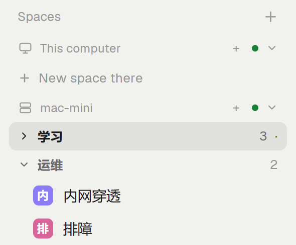

# Space Groups

The left sidebar shows spaces under each machine. Names like `Study·anki`
share a clickable `Study` heading, with `anki` indented beneath it.
A closed heading still shows how many spaces it holds and whether one needs
attention.

## What you see

- A theme-colored sidebar starts with the existing 31 px Spaces toolbar and
  its new-space button. The list beneath scrolls vertically.
- When another machine is known, 26 px machine headings separate this
  computer and the remote machines. They retain their connection colors,
  add controls and connection guidance.
- Each 26 px prefix heading shows an 11 px arrow, an 11.5 px semibold name
  and a member count. It uses the theme's muted text and its hover and
  selection backgrounds.
- Space rows are 30 px high, with 28 px worktree rows. Group members have
  14 px of extra left padding. Worktrees have another 22 px and a branch
  icon. Other rows have the built-in 18 px colored avatar. Git details appear
  to the right when relevant.
- Below 160 logical px, the sidebar shows the built-in 32 px wide numbered
  rail cells with machine icons and per-space status glyphs.

## How it behaves

- Click a group heading to fold or unfold it. The arrow points right when
  folded and down when open. A folded group containing the selected space
  has the theme's selected background. An open group shows its selected
  member in the usual way.
- A folded group's status follows the priority blocked, done, working,
  idle. Blocked and done use a filled dot in the corresponding theme color.
  Working and idle use a middle dot in their theme colors. Hover the glyph
  for the status name. A group with no reported status has no glyph.
- Click a space to select it, right-click for its space menu, or drag it
  onto another visible space on the same machine to reorder. A group's
  position follows its first member. A repo and its linked worktrees nest
  together when they share a group. Changing a space's name can change
  its group.
- The rail gives every space a numbered selection cell, including members
  hidden by prefix folds in the wider sidebar. Machine headings still
  fold their entire machine in both widths. Widening the sidebar restores
  the previous prefix folds. Existing Herdr shortcuts still work.

## Built from

- Clone the `main` layout and keep its node tree. Under
  `sidebar → sidebar-lists → spaces`, point the spaces block at
  `space-groups`. The mod has `place: "none"` and takes no props.
- Build from the Spaces mod in Herdr 0.1.15. Reuse the `menu` overlay with
  `{ tab: "space", target: { id } }` and the supplied `workspace-chrome`
  SVGs for chevrons, the branch, machine icons and plus buttons. There is no
  custom artwork.
- Read `spaces()`, `panes()`, `machines()`, `theme()`, `layout()`,
  and `window()`. Keep the upstream `space.colors` shared state,
  `watchFolder()` ref watches, `openOverlay()`, and `run()` for space
  selection, movement, creation and machine settings. Keep upstream Git
  ref queries through `exec()` and machine listing/reconnection through
  `hc()`. Prefix grouping itself uses no external programs.
- Use the first `SEP` (`·`, U+00B7) in a named space's name. Trim both
  parts. Use the pair of machine name and prefix as the group identity.
  Keep the folded keys as a JSON array in this mod copy's `localStorage`
  at `space-groups.folded`.

## Watch out

- Automatic names bypass the split. Subsequent middle dots are part of the
  displayed suffix. Empty prefixes get the label `(empty group)`.
- A worktree with a different prefix from its main checkout follows its own
  name. Grouped worktree nesting is a display rule so it need not shuffle
  other groups. Keep the shipped ordering behavior for ungrouped worktrees.
- Use the underlying space index for drag destinations and rail numbering.
  A drag target must be visible. Group headers cannot be dragged or used
  as drop targets.
- Machine folding and prefix folding are separate. Never put prefix fold
  state in shared space data. The client needs a Herdr version with the
  shipped menu and icon paths used by the 0.1.15 baseline.

## Done when

- `herdr-app check` passes for the mod folder and the pure grouping tests pass.
- Two machines with a common prefix show separate headings, and an
  unprefixed or automatically named space stays outside the headings.
- Folding a group leaves the count, highest-priority status, and selected
  highlight visible. Closing and reopening the same layout retains the fold.
- Selecting, opening a context menu and dragging visible rows work. A
  same-group worktree nests beneath its repo and displays its Git details.
- Narrowing the sidebar reveals the rail entries even for folded groups.
  Widening it restores the folds.
